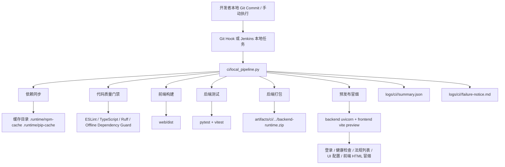

# 本地离线 CI/CD 体系设计与落地说明

## 1. 目标与边界

本方案面向当前 `AI-Law-Assistant` 项目，目标是在 **单机 Windows 本地环境** 下建立一套可执行、可调试、可留痕、可离线运行的 CI/CD 体系，用于支撑：

- 前后端代码质量门禁
- 前后端独立构建与可复现产物输出
- 单元 / 集成 / 预发布冒烟验证
- 本地 Git 提交触发与手动触发
- 失败日志归档与快速定位

本次方案的正式选型为：

- **主工具链**：`Jenkins LTS（本地部署） + 仓库内置 Python Local Runner`
- **触发模式**：
  - 手动触发：`python ci/local_pipeline.py run --profile full`
  - 本地提交触发：Git `post-commit` Hook
- **不作为主选型的工具**：
  - `act`：需要 Docker 镜像缓存，离线准备成本高
  - `GitLab Runner`：对当前单仓库本地场景偏重

之所以采用该组合，是因为当前项目存在以下约束：

- Windows 本地运行，且长期要求 **脱离云端服务**
- 后端含 OCR / LLM / 向量模型等重依赖，不适合把 CI 主执行逻辑绑死在容器镜像上
- 项目已有 Python 启动脚本、前后端本地服务编排脚本，适合继续沿用
- 需要支持本地断点调试和逐阶段复跑，仓库内置 runner 比纯平台配置更灵活

## 2. 项目现状调研

### 2.1 技术栈梳理

#### 后端

- 语言：Python 3.12
- Web 框架：FastAPI
- 服务入口：`app/main.py`
- 关键依赖：
  - API / 网络：`fastapi`、`uvicorn`、`httpx`
  - 文档处理：`python-docx`、`pypdf`、`pypdfium2`
  - OCR / 版面分析：`mineru`、`doclayout-yolo`、`onnxruntime`
  - 模型与 NLP：`transformers`、`modelscope`、`jieba`
  - 鉴权：`pyjwt`、`bcrypt`、`passlib`

#### 前端

- 语言：JavaScript / TypeScript
- 框架：React 18 + Vite
- 测试：Vitest + Testing Library
- 代码质量：ESLint
- 新增能力：TypeScript `tsc --noEmit` 类型检查

### 2.2 现有测试覆盖面

#### 前端

- 命令：
  - `npm run lint`
  - `npm run typecheck`
  - `npm run test`
  - `npm run build`
- 关键测试点：
  - 登录与认证状态
  - 合同预览
  - 审计结果状态持久化
  - 错误目录与错误载荷

#### 后端

- 命令：
  - `python -m pytest tests`
- 核心测试类型：
  - API 基础可用性
  - LLM 路由与本地模式
  - 合同审计错误载荷
  - PDF / Preview / Source Download
  - Memory Pipeline / Tax Audit / OCR / Export

### 2.3 生产核心功能场景

本地 CI/CD 中必须纳入验证闭环的核心场景如下：

1. 用户登录与会话恢复
2. 合同审计页加载与基础配置获取
3. 合同预览资源访问
4. 法规列表与检索 API 基础可用
5. 审计结果前端渲染逻辑不回归
6. 本地配置 / 端口 / 静态资源构建链路稳定

## 3. 方案架构

### 3.1 架构图



### 3.2 流水线执行节点

| 阶段 | 说明 | 失败策略 | 产物 |
| --- | --- | --- | --- |
| `workspace_probe` | 探测 Python / npm 运行环境 | 失败即终止 | 环境日志 |
| `deps_lock` | 引导 `pip-tools`、执行 `piptools sync`、校验锁文件与当前虚拟环境，再同步 Node 依赖 | 失败即终止 | 安装日志 |
| `python_dependency_check` | 快速校验 `.in` 源、锁文件与当前 Python 环境是否一致 | 失败即终止 | 依赖校验日志 |
| `frontend_lint` | 前端 ESLint | 失败即终止 | 质量日志 |
| `frontend_typecheck` | 前端 TS 类型检查 | 失败即终止 | 类型日志 |
| `frontend_unit` | Vitest 单测 | 失败即终止 | 测试日志 |
| `frontend_build` | Vite 构建 | 失败即终止 | `web/dist` |
| `backend_static` | Ruff 静态扫描 | 失败即终止 | 质量日志 |
| `backend_security` | 离线依赖基线扫描 | 失败即终止 | 安全日志 |
| `backend_unit_core` | 后端核心用例集 | 失败即终止 | pytest 日志 |
| `backend_unit_full` | 后端生产稳定矩阵（排除已知遗留红灯套件） | 失败即终止 | pytest 日志 |
| `backend_package` | `compileall` + 运行包打包 | 失败即终止 | `backend-runtime.zip` |
| `prerelease_smoke` | 本地预发布启动与冒烟 | 失败即终止 | 冒烟报告 |

### 3.3 并行与资源配额策略

为了适配本地单机环境，本方案默认执行以下资源控制：

- 最大并行度：`2`
- Node 内存：`--max-old-space-size=3072`
- `OMP_NUM_THREADS=2`
- `MKL_NUM_THREADS=2`
- `VITEST_MAX_THREADS=2`
- `UVICORN_WORKERS=1`
- 模型相关并行关闭：`TOKENIZERS_PARALLELISM=false`

并行策略：

- `frontend_lint` 与 `frontend_typecheck` 可并行
- `backend_static` 与 `backend_security` 可并行
- 大测试阶段与冒烟阶段默认串行，避免本机资源争抢

## 4. 目录与配置落地

### 4.1 新增关键文件

- `ci/local_pipeline.py`：本地流水线执行入口
- `ci/local-pipeline.config.json`：流水线配置与资源配额
- `ci/offline_dependency_guard.py`：离线依赖安全基线扫描
- `ci/package_backend.py`：后端打包脚本
- `ci/smoke_runtime.py`：预发布本地冒烟验证
- `ci/install_git_hook.py`：安装本地 Git Hook
- `.githooks/post-commit`：本地提交自动触发脚本
- `Jenkinsfile`：本地 Jenkins 入口
- `.ruff.toml`：后端静态扫描配置
- `app/requirements.in`：后端生产直接依赖声明
- `app/dev-requirements.in`：后端开发直接依赖声明
- `app/requirements.txt`：`pip-tools` 生成的生产锁文件
- `app/dev-requirements.txt`：`pip-tools` 生成的开发锁文件
- `ci/check_python_dependencies.py`：锁文件再生成校验与环境一致性校验
- `web/tsconfig.json`：前端类型检查配置

### 4.2 本地缓存目录

- Python：`.runtime/pip-cache`
- Node：`.runtime/npm-cache`
- 日志：`logs/ci/<run-id>`
- 产物：`artifacts/ci/<run-id>`

## 5. 使用方式

### 5.0 Python 依赖维护规范

- 仅允许修改 `app/requirements.in` 与 `app/dev-requirements.in`
- 禁止手动编辑 `app/requirements.txt` 与 `app/dev-requirements.txt`
- 每次依赖变更后必须重新生成锁文件，并执行同步与测试
- 建议按季度集中升级依赖，在完整测试通过后统一提交锁文件

锁文件生成命令：

```powershell
& "d:\Workspace\AI-Law-Assistant\app\.venv\Scripts\python.exe" -m piptools compile --resolver=backtracking --output-file "d:\Workspace\AI-Law-Assistant\app\requirements.txt" "d:\Workspace\AI-Law-Assistant\app\requirements.in"
& "d:\Workspace\AI-Law-Assistant\app\.venv\Scripts\python.exe" -m piptools compile --resolver=backtracking --output-file "d:\Workspace\AI-Law-Assistant\app\dev-requirements.txt" "d:\Workspace\AI-Law-Assistant\app\dev-requirements.in"
& "d:\Workspace\AI-Law-Assistant\app\.venv\Scripts\python.exe" -m piptools sync "d:\Workspace\AI-Law-Assistant\app\requirements.txt" "d:\Workspace\AI-Law-Assistant\app\dev-requirements.txt"
```

### 5.1 手动触发

#### 快速检查

```powershell
& "d:\Workspace\AI-Law-Assistant\app\.venv\Scripts\python.exe" `
  "d:\Workspace\AI-Law-Assistant\ci\local_pipeline.py" run --profile quick
```

#### 全量流水线

```powershell
& "d:\Workspace\AI-Law-Assistant\app\.venv\Scripts\python.exe" `
  "d:\Workspace\AI-Law-Assistant\ci\local_pipeline.py" run --profile full
```

### 5.2 查看执行计划

```powershell
& "d:\Workspace\AI-Law-Assistant\app\.venv\Scripts\python.exe" `
  "d:\Workspace\AI-Law-Assistant\ci\local_pipeline.py" plan --profile full
```

### 5.3 断点调试流水线

从指定阶段继续执行：

```powershell
& "d:\Workspace\AI-Law-Assistant\app\.venv\Scripts\python.exe" `
  "d:\Workspace\AI-Law-Assistant\ci\local_pipeline.py" run --profile full --from-stage backend_unit_full
```

只跑部分阶段：

```powershell
& "d:\Workspace\AI-Law-Assistant\app\.venv\Scripts\python.exe" `
  "d:\Workspace\AI-Law-Assistant\ci\local_pipeline.py" run --profile full --only frontend_build,prerelease_smoke
```

失败后继续：

```powershell
& "d:\Workspace\AI-Law-Assistant\app\.venv\Scripts\python.exe" `
  "d:\Workspace\AI-Law-Assistant\ci\local_pipeline.py" run --profile full --keep-going
```

### 5.4 安装本地 Git 提交触发

```powershell
& "d:\Workspace\AI-Law-Assistant\app\.venv\Scripts\python.exe" `
  "d:\Workspace\AI-Law-Assistant\ci\install_git_hook.py"
```

安装完成后，每次本地 `git commit` 完成都会自动执行 `quick` 流水线。

### 5.5 Jenkins 本地运行

若已在本机安装 Jenkins：

1. 新建 Pipeline Job
2. 指向当前仓库根目录
3. 使用仓库内 `Jenkinsfile`
4. 通过参数切换 `quick / full`

## 6. 预发布仿真说明

`prerelease_smoke` 阶段会在本机模拟生产前验证：

1. 创建或重置本地管理员账号
2. 启动后端 `uvicorn`
3. 启动前端 `vite preview`
4. 依次验证：
   - `/health`
   - `/api/auth/login`
   - `/api/auth/me`
   - `/regulations`
   - `/contracts/ui-config`
   - 前端首页 HTML 访问

该阶段的目标是验证 **服务连通性、认证闭环、核心 API 可用性、静态资源可访问性**。

## 7. 测试通过标准

本地流水线通过标准定义如下：

- `ci/check_python_dependencies.py` 必须通过：
  - `requirements.in` / `dev-requirements.in` 能重新推导出当前锁文件
  - 当前虚拟环境安装版本与锁文件完全一致
- `piptools sync` 后不得残留未锁定的额外 Python 包
- 前端 lint / typecheck / unit / build 全部通过
- 后端 static / security / core / full-stable / package / smoke 全部通过

1. 所有质量门禁阶段返回码为 `0`
2. 前端 `lint / typecheck / unit / build` 全部通过
3. 后端 `ruff / offline dependency guard / pytest` 全部通过
4. 后端运行包成功生成
5. 预发布冒烟报告 `status=passed`
6. `logs/ci/<run-id>/summary.json` 中最终 `status=passed`

### 7.1 当前隔离的遗留红灯套件

为了让本地 `full` 流水线能够稳定承担生产门禁职责，当前默认阻断矩阵中暂时隔离以下已知遗留红灯套件：

- `tests/test_audit_prompt.py`
- `tests/test_audit_tax.py`
- `tests/test_export_jobs.py`
- `tests/test_memory_pipeline_fallback.py`
- `tests/test_tax_audit_crud.py`
- `tests/test_tax_audit_pipeline.py`
- `tests/test_tax_contract_parser.py`
- `tests/test_tax_lifecycle.py`
- `tests/test_tax_matcher.py`
- `tests/test_tax_parser.py`
- `tests/test_tax_report.py`
- `tests/test_tax_risk.py`

这些测试暴露的典型问题包括：

- 历史断言与现行 Prompt 文案不一致
- 税务链路规则判断与预期不一致
- SQLite 初始化 SQL 含重复字段定义
- 部分测试运行时依赖的配置前置条件缺失

因此，当前 `full` profile 的定义是：

- **阻断生产门禁**：后端生产稳定矩阵
- **遗留回归观察**：上述隔离套件单独修复后再重新纳入阻断门禁

## 8. 故障排查

### 8.1 `deps_lock` 失败

常见原因：

- `.venv` 未创建
- npm 缓存损坏
- `package-lock.json` 与 `package.json` 不一致

建议处理：

```powershell
Remove-Item -Recurse -Force "d:\Workspace\AI-Law-Assistant\.runtime\npm-cache" -ErrorAction SilentlyContinue
Remove-Item -Recurse -Force "d:\Workspace\AI-Law-Assistant\.runtime\pip-cache" -ErrorAction SilentlyContinue
```

### 8.2 `frontend_typecheck` 失败

说明新增或现有 TS 文件不满足类型约束，优先查看：

- `web/tsconfig.json`
- `logs/ci/<run-id>/frontend_typecheck.log`

### 8.3 `backend_static` 失败

说明存在语法级或未定义符号级错误，查看：

- `.ruff.toml`
- `logs/ci/<run-id>/backend_static.log`

### 8.4 `prerelease_smoke` 失败

重点排查：

- 端口占用：`18001` / `14173`
- 管理员账号是否可创建
- `web/dist` 是否为最新构建产物
- 后端配置中的静态目录和数据库路径是否可访问

重点日志：

- `logs/ci/<run-id>/prerelease_smoke.log`
- `artifacts/ci/<run-id>/smoke/smoke-summary.json`

### 8.5 提交后自动触发未执行

重点检查：

- `.git/hooks/post-commit` 是否已安装
- 当前 Git 客户端是否启用了 hook
- `app/.venv/Scripts/python.exe` 是否存在

## 9. 后续增强建议

1. 将 `ci/security/python-advisories.json` 接入企业内网安全基线镜像，形成真正的离线 CVE 基线库
2. 为 `prerelease_smoke` 增加浏览器级 E2E 验证
3. 将 `backend_unit_full` 细分为更明确的单元 / 集成矩阵
4. 为大模型链路补充可控 Mock Profile，用于稳定覆盖完整合同审计主流程
