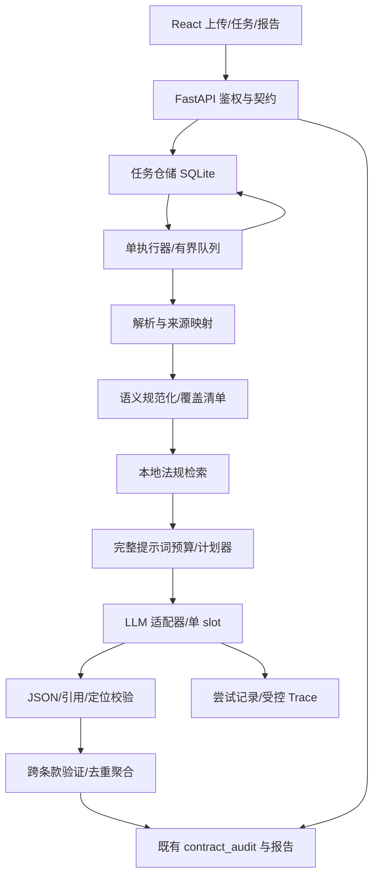

# 02 架构与技术决策

## 1. 现状到目标

现状：浏览器长 POST → 合同路由 → 同步编排器 → 解析/检索/多轮 LLM → 写结果 → 返回。进度仅在进程内字典，重启丢失；线程池补丁解决事件循环阻塞，但未解决任务持久化、所有权和刷新恢复。

目标：短提交 + SQLite 持久化队列 + 单执行器。先修覆盖，再切换任务 API；无需分布式平台。



依赖只向下：UI → 路由 → 任务/领域服务 → 仓储或模型适配器。领域模块禁止 import 路由，模型适配器禁止直接更新 UI。回调仅写结构化事件；不可用全局变量传当前任务 ID。

## 2. 技术选型

| 层 | 采用 | 理由/约束 |
|---|---|---|
| 前端 | 保留 React 18、Vite、现有 CSS 与双语体系 | 不做 UI 换框架；新增任务 Hook/组件 |
| 后端 | 保留 FastAPI、Pydantic v2、Python 3.12 x64 为主认证 | 不宣称文档中的 3.10+ 已全部回归 |
| 执行 | lifespan 管理的单后台线程，任务轮询 SQLite | 可复用现有同步 pipeline；不得在 async 路由直接跑推理 |
| 数据 | Python sqlite3、本地磁盘、WAL、短事务 | 不上网络共享 SQLite；不要跨线程共享连接 |
| 推理 | 固定版本 llama.cpp CPU，GGUF 主模型 | OpenAI 兼容端点；版本/模板/二进制哈希入账 |
| 检索 | 现有 SQLite/BM25 + ONNX Embedding | 不为数秒检索引入新数据库 |
| 文档 | 现有 PDF/DOCX/OCR 管线，增加来源映射适配层 | OCR 依赖可选，扫描件无 OCR 必须明确失败 |
| 测试 | pytest、pytest-asyncio、Vitest、Testing Library | 性能测试直接 HTTP/脚本；不依赖公网 CI |
| 运维 | PowerShell/Python 原生脚本、JSONL 日志和本地状态摘要 | Grafana 等不是交付前置条件 |

版本以 P0 验证后生成的锁定清单为准。现有 requirements 含范围依赖，不能原样宣称完全可复现。Node 24 是工作机观察版本，正式认证使用验证后的同一 Node 版本和 lockfile。

## 3. ADR 决策记录

| ID | 决策 | 放弃的方案及原因 |
|---|---|---|
| ADR01 | 正确性门在性能门之前 | 直接减少轮数会扩大已有漏段风险 |
| ADR02 | 先保留模型，优化输入结构 | 默认换小模型会混淆算法收益和质量变化 |
| ADR03 | 一个执行器，所有业务模型请求走统一限流器 | 合同线程池并发不等于 CPU 推理吞吐提升 |
| ADR04 | 新 202 接口并行兼容旧接口 | 直接把旧 200 改 202 会破坏现有调用方 |
| ADR05 | 进度以 DB 为准，内存仅作临时通知 | 多线程/重启后内存字典不能作为真相来源 |
| ADR06 | 不自动恢复 running 任务 | 同步模型请求断线后是否仍执行未知，贸然重试可重复计算 |
| ADR07 | 语义单元与现有预览 cN ID 分离 | 重排 ID 会破坏风险定位与旧报告 |
| ADR08 | 默认不缓存 LLM 最终答案 | 模型、法规、提示词和权限变化导致复用风险；先做解析与 KV 缓存 |
| ADR09 | 不增加 LLM 专门生成最终报告 | 使用现有确定性聚合/渲染，避免额外耗时及引用失真 |

## 4. 任务生命周期

持久化 `status` 枚举：

```text
queued -> running -> done
queued -> cancelled
running -> cancelling -> cancelled
running -> failed
running/cancelling -> interrupted       (进程异常退出后恢复检查)
```

终态为 `done/failed/cancelled/interrupted`，不能原地重新变成 running。用户重试创建新任务和新 ID，记录 `retry_of`；本期不复用旧块结果。queued 重启后保留，按入队时间继续。

`stage` 枚举依次为 `queued/extracting/normalizing/retrieval/planning/auditing/validating/finalizing/done`。失败、取消和中断用 `stage=failed/cancelled/interrupted`，另存 `last_active_stage`。重试或缺失风险复核可继续 auditing，但不倒退进度。

执行器工作顺序：

1. 启动获取应用数据目录的 OS 进程锁；第二实例拒绝启动。禁止多 uvicorn workers。
2. 同一应用实例写 owner ID；持锁启动时，将上次遗留 running/cancelling 原子标记 interrupted。
3. 确认模型无未知在途请求；不能确认时保持暂停接单，管理员解除，禁止“健康即空闲”的假设。
4. 每秒取最老 queued；`BEGIN IMMEDIATE` 检查状态并 CAS 更新 running，立即提交。
5. 在线程中跑同步流水线。每阶段、每块前后、每次请求前检查取消与总时限。
6. 成功写结果、任务 done、最终事件同一事务提交；任何错误不得写 done。
7. 关闭时停止接单，等待在途请求最多 30 秒；未排空标记 interrupted，不杀用户其他模型服务。

模型全局限流范围：合同、独立税审、记忆辅助、Admin 模型测试，按相同 API endpoint 共享容量 1。后台任务执行不能持 DB 事务等待模型锁。排队中的模型等待也计入任务总时限。新增异步路由用线程桥或异步锁等待，不阻塞事件循环。

## 5. 新配置契约（待实现）

新增 `audit_optimization`，由 Pydantic 显式校验；禁止现有 `or default` 逻辑吞掉非法零值。

| 键 | 初始默认值 | 校验/含义 |
|---|---|---|
| enabled | false | P6 验收批准后设 true；正确性保护不随开关关闭 |
| engine_version | `"v2"` | 固定版本用于回放 |
| context_tokens | 16384 | 必须与运行 slot 上限一致，不一致拒绝运行 |
| safety_tokens | 1024 | ≥256；计入每块完整预算 |
| output_tokens | 1536 | 512～4096；预算和发送 max_tokens 同源 |
| input_target_tokens | 7000 | 初始调优值；必须小于 context-output-safety |
| max_chunks | 64 | 1～256；超过明确失败，不允许丢尾段 |
| max_active_jobs | 1 | 本期只允许 1 |
| max_queued_jobs | 3 | 队列满返回 429 |
| request_timeout_seconds | 600 | 单次请求上限；不无限延长 |
| task_timeout_seconds | 5400 | 从开始 running 起算，含检索、锁等待、重试 |
| max_attempts_per_chunk | 2 | 首次 + 一次重试；上下文重新规划也消耗该块重试预算 |
| max_retries_per_job | 3 | 含 JSON 修复和跨条款复核之外的失败重试；全局总量 |
| max_cross_checks | 8 | 缺失类风险附加模型复核上限，超出标人工复核 |
| polling_ms / heartbeat_seconds | 2000 / 5 | 前端串行轮询；后台独立心跳 |
| parse_cache_enabled | true | 用户隔离；见 05 |
| prompt_cache_enabled | false | llama.cpp 能力实测通过后开启；不允许仅按名称推断支持 |
| raw_trace_enabled / raw_trace_days | false / 7 | 诊断显式启用；元数据默认保留 |

配置优先级：任务创建时冻结的已校验 `audit_optimization` > v2 内建默认值。请求端不得覆盖资源限制、模型路径或系统 prompt。v1 仍读取既有键；启用 v2 时 `classic_audit_max_tokens` 不得再次覆盖 v2 的有效输出预算。

仅允许新增/已有白名单的业务选项参与任务配置；所有任务记录最终参数 hash。`APP_CONFIG` 选择配置文件，路径相对于该文件目录解析；新增 cache/trace 路径必须同步纳入 `app/core/config.py` 路径标准化。

## 6. 性能边界

不通过扩容 slot 达成验收；先比较 CPU generation threads 4/6/8/10 和 prompt batch。默认 `--threads`、`--threads-batch` 的最优值由 P5 决定，不预先承诺 6 一定最快。`--batch-size` 512/1024，`--ubatch-size` 256/512；每组参数使用同一输入、相同模板、相同输出任务。

核显加速、低比特 KV cache、投机解码、小模型均是独立实验，不进入主路径依赖。所有候选必须记录运行时能力与内存峰值，失败自动回到已认证配置而非云端模型。
